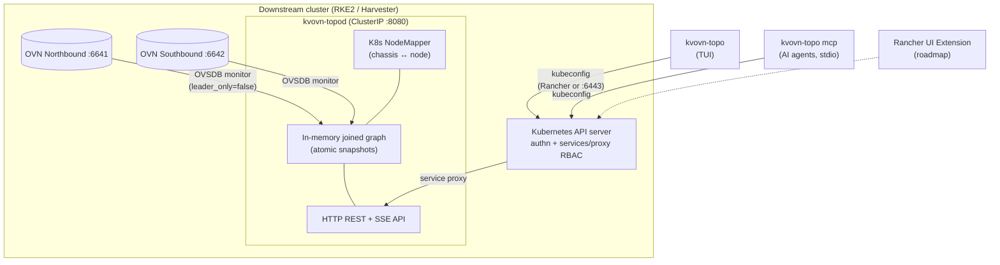

<p align="center">
  
</p>

<p align="center">
  <strong>Read-only network topology explorer for OVN on Kube-OVN (RKE2, Harvester) and ovn-kubernetes.</strong>
</p>

<p align="center">
  <a href="go.mod"></a>
  <a href="https://github.com/coulof/kvovn-topo/releases"></a>
</p>

---

kvovn-topo shows how the OVN logical network of a Kubernetes cluster is wired: VPCs, routers, switches, ports, chassis and the pods and VMs behind them. It reads the OVN Northbound and Southbound databases directly, and joins them into one live graph.

It consists of:
- **`kvovn-topod`**: a Go daemon that monitors the OVN NB and SB databases, joins them into an in-memory graph, and serves it over HTTP JSON and SSE.
- **`kvovn-topo`**: a k9s-style terminal UI over the same graph.
- **`kvovn-topo mcp`**: an MCP server, so AI agents (OpenCode, Claude Code, agy) can query the graph read-only.

<p align="center">
  
</p>

---

## Features

- 🔒 **Read-only by design**: never writes to OVSDB or to the Kubernetes API, enforced by lint in CI.
- 🗺️ **Live joined graph**: NB and SB rows joined into VPCs, routers, switches, ports, chassis, NAT, routes, policies and load balancers.
- ⚡ **Push updates**: OVSDB monitors in, Server-Sent Events out; no polling.
- 🖥️ **k9s-style TUI**: tree views, relations you can follow, a details pane that explains each object, problems and changes.
- 🩺 **Opt-in, contextual diagnostics** (`--diag`): `ovn-trace`, tcpdump, conntrack, OVS ports and bridges, `ovn-controller` logs, always run for the selected object on the node that hosts it.
- 🤖 **MCP server**: AI agents can search and read the topology with Tier 0 tools.
- 🧩 **Kube-OVN, Harvester and KubeVirt aware**: pods and VMs mapped to their ports, chassis mapped to nodes.
- 🔴 **OpenShift / ovn-kubernetes**: one node (zone) at a time, live or from a capture.
- 🔐 **No exposed endpoint**: reached through the Kubernetes API service proxy, authorized by `services/proxy` RBAC.
- 📦 **Air-gap friendly**: static binaries, a distroless image and a Hauler manifest.

---

## Architecture

The TUI and `kvovn-topo mcp` reach the daemon through the Kubernetes API server's service proxy. No port-forward, public IP or Ingress is needed:



The API server authenticates the kubeconfig user and checks `services/proxy` RBAC on `kube-system/kvovn-topod`. The security design is in the [API & Security Reference](docs/api.md).

---

## Installation

### 1. In-cluster daemon (`kvovn-topod`), RKE2 and Harvester

```bash
helm install kvovn-topo oci://ghcr.io/coulof/charts/kvovn-topo --namespace kube-system
```

TLS, endpoints and viewer RBAC are in the [chart README](charts/kvovn-topo/README.md#installation).

### 2. Client (`kvovn-topo`)

Linux (amd64) and macOS (arm64), into `~/.local/bin`:

```bash
OS=linux ARCH=amd64          # macOS: OS=darwin ARCH=arm64
VERSION=$(curl -fsSLI -o /dev/null -w '%{url_effective}' https://github.com/coulof/kvovn-topo/releases/latest)
VERSION=${VERSION##*/v}
curl -fsSL "https://github.com/coulof/kvovn-topo/releases/download/v${VERSION}/kvovn-topo_${VERSION}_${OS}_${ARCH}.tar.gz" \
  | tar -xz "kvovn-topo_${OS}_${ARCH}"
mkdir -p ~/.local/bin && install -m 0755 "kvovn-topo_${OS}_${ARCH}" ~/.local/bin/kvovn-topo
```

Windows (amd64): download `kvovn-topo_<version>_windows_amd64.zip` from [GitHub Releases](https://github.com/coulof/kvovn-topo/releases) and put `kvovn-topo.exe` on your `PATH`.

---

## Terminal UI (`kvovn-topo`)

```bash
export KUBECONFIG=~/.kube/hv-01.yaml
kvovn-topo            # passive (Tier 0)
kvovn-topo --diag     # plus exec-based diagnostics (Tier 1)
```

- 🌳 **Three tree views**: `1` VPCs, `2` Chassis, `3` Workloads (pods and VMs with their NICs).
- 🚨 **Problems** (`4`): unbound ports, gateways without a chassis, NAT-gateway return paths.
- 🕒 **Changes** (`5`): everything that changed since start, live.
- 🔗 **Relations**: `Enter` follows a `⇢` relation to another object, `b` comes back.
- 📋 **Details pane** (`i`): what the selection is and how it interconnects; `d` describes it, `y` shows the raw OVSDB row.
- 🔎 **Filter and commands**: `/` filters rows and keeps their ancestors for context; `:` jumps to a view, k9s-style.
- 📡 **Live updates** over SSE, with changed rows highlighted; falls back to polling when a proxy buffers the stream.
- 🩺 **Diagnostics** (`x`, with `--diag`): `ovn-trace`, tcpdump, conntrack, OVS ports and bridges, flows and `ovn-controller` logs, run on the node that hosts the selection ([§6](docs/tui-guide.md#6-tier-1-diagnostics--x-requires---diag)).
- ▶️ **Inspect commands** (`!`): run a details-pane command such as `kubectl ko nbctl lr-route-list` with the TUI suspended.
- 🧭 **Pod autodetection**: finds `ovn-central`, `kube-ovn-cni` and `ovs-ovn` for Kube-OVN, else `ovnkube-node` for ovn-kubernetes; `--k8s-namespace` pins the namespace.
- ⚙️ **Config file**: theme, highlight duration and per-context daemon settings in `~/.config/kvovn-topo/config.yaml` ([§0](docs/tui-guide.md#config-file)).
- 💾 **Offline**: `--fixture` (bundled dataset) or `--fixture-dir` (a capture), no cluster needed.

`?` lists every key. The [TUI guide](docs/tui-guide.md) walks through use cases with screenshots, and its [§8](docs/tui-guide.md#8-keys) has the full key table.

### OpenShift: one node at a time

OpenShift runs [ovn-kubernetes](https://ovn-kubernetes.io/) in interconnect mode: one NB/SB per node and no central database, so there is no daemon yet. The TUI reads one node (zone) at a time, live through an exec relay or offline from a capture:

```bash
kvovn-topo --diag --zone list       # the zones (nodes)
kvovn-topo --diag --zone <node>     # live, through a pods/exec relay to the node's sockets
KUBECTL=oc hack/capture-fixtures.sh <name> --flavor ovnk
kvovn-topo --fixture-dir testdata/scenarios/<name>/zone-<node>   # offline
```

How it works and its quirks: [OpenShift implementation](docs/openshift-implementation.md). The cluster-wide design is proposed in [ADR-0005](docs/adr/0005-ovnk-interconnect.md#decision).

---

## Model Context Protocol (MCP)

`kvovn-topo mcp` serves Tier 0 tools to AI agents over stdio.

### Available Tools
- `find`: Search routers, switches, ports, and chassis by name, IP, MAC, namespace, pod, or VM.
- `get_graph`: Retrieve the L3, L2, or chassis topology graph.
- `get_node`: Show full detail of one node, including OVSDB columns and Kubernetes identity.
- `list_chassis`: List OVN chassis with binding counts and gateway roles.

### Tool Setup

`kvovn-topo` must be on the agent's `PATH`, or use an absolute path.

#### 1. OpenCode
Add this to your `opencode.json` (or `~/.config/opencode/opencode.json`):

```json
{
  "mcp": {
    "kvovn-topo": {
      "type": "local",
      "command": ["kvovn-topo", "mcp"],
      "enabled": false
    }
  }
}
```

#### 2. Claude Code
```bash
claude mcp add kvovn-topo -- kvovn-topo mcp
```

#### 3. agy
```bash
agy mcp add kvovn-topo -- kvovn-topo mcp
```

Backends, result caps and offline use are in the [MCP guide](docs/mcp.md); ready-made prompts are in [docs/mcp-prompts.md](docs/mcp-prompts.md).

---

## Documentation

- [TUI guide](docs/tui-guide.md): use cases, screens and keys.
- [OpenShift implementation](docs/openshift-implementation.md): ovn-kubernetes zones, live and offline modes, quirks.
- [Concepts](docs/concepts.md): OVN, Kube-OVN and ovn-kubernetes objects, and what goes wrong with them.
- [MCP guide](docs/mcp.md) and [MCP prompts](docs/mcp-prompts.md).
- [Development](docs/development.md): build, test, local daemon, releases.
- [API and security](docs/api.md): endpoints, service-proxy access, read-only guarantees.
- [ADRs](docs/adr/): privilege tiers, history, MCP server, CNI flavors, ovn-kubernetes interconnect.
