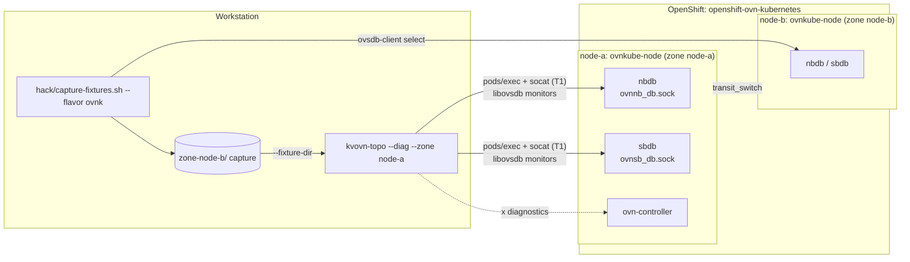

# OpenShift (ovn-kubernetes) implementation

OpenShift 4.14+ runs [ovn-kubernetes](https://ovn-kubernetes.io/) in **interconnect mode**: every node is its own OVN *zone*, with its own NB and SB databases, and there is no central database for `kvovn-topod` to monitor. Until the per-node collectors of [ADR-0005](adr/0005-ovnk-interconnect.md) exist, `kvovn-topo` reads **one zone at a time**, either live or from a capture.

For the upstream concepts (zones, `transit_switch`, gateway routers), see the [ovn-kubernetes documentation](https://ovn-kubernetes.io/). [concepts.md](concepts.md) maps the Kube-OVN, OVN and ovn-kubernetes names side by side.

## How the TUI reaches a zone



### Live (TUI, Tier 1)

```bash
kvovn-topo --diag --zone list       # the zones (one per node)
kvovn-topo --diag --zone <node>     # live view of that node's zone
```

- `kvovn-topo` opens a `pods/exec` stream to `socat` in the node's `ovnkube-node` pod (`nbdb` and `sbdb` containers), connected to the database's unix socket. The `socat` command comes from the typed allowlist in `pkg/diag` (`pkg/diag/ovsdbrelay.go`).
- libovsdb monitors run over that stream, so changes appear live, as with the daemon. The graph is served to the TUI itself on `127.0.0.1`.
- Nothing is deployed in the cluster.

### Offline (TUI or MCP)

For MCP clients, for users without exec rights, or to keep a snapshot:

```bash
# Read-only: ovsdb-client select queries and kubectl get. One directory per zone.
KUBECTL=oc hack/capture-fixtures.sh my-cluster --flavor ovnk

kvovn-topo --fixture-dir testdata/scenarios/my-cluster/zone-<node>
kvovn-topo mcp --fixture-dir testdata/scenarios/my-cluster/zone-<node>
```

The capture holds real names, IPs and MACs. Keep it out of the repository.

## Implementation quirks

- **No central database, no Service.** Each zone's `nbdb`/`sbdb` run inside the node's `ovnkube-node` pod and listen only on unix sockets (`/var/run/ovn/ovn{nb,sb}_db.sock`; on the host `/var/run/ovn-ic`, `root:root 0750`). There is no `ovn-nb`/`ovn-sb` Service, so changing the namespace does not help the daemon.
- **The chart refuses OpenShift.** It detects `config.openshift.io/v1` and, with the default endpoints, fails the install rather than deploy a daemon that is never ready. For a central-DB ovn-kubernetes, set `ovn.nbEndpoints`/`ovn.sbEndpoints`; the chart then leaves the UID to the `restricted-v2` SCC ([chart README](../charts/kvovn-topo/README.md#openshift-ovn-kubernetes)).
- **Live mode is Tier 1.** Reaching the sockets needs `pods/exec` into `openshift-ovn-kubernetes`, which in practice means cluster-admin. It is TUI-only and behind `--diag`; MCP does not offer it.
- **The sockets accept writes.** OVN has no read-only role. `kvovn-topo` stays read-only only because of its own code: no OVSDB write calls, enforced by `forbidigo` in CI.
- **Zones are copies, not partitions.** Every zone holds `ovn_cluster_router`, `join`, `transit_switch`, all Port_Groups, Address_Sets and most Load_Balancers, with different row UUIDs. Only the node switch `<node>`, `GR_<node>`, `ext_<node>`, the zone's pod ports, NAT rows and Port_Bindings are local.
- **Traffic stops at `transit_switch`.** Other nodes appear as `type=remote` `tstor-<node>` ports; a trace or a path ends there. A cluster-wide view needs the ADR-0005 merge.
- **`x` diagnostics follow the object, not the zone.** They run in the `ovnkube-node` pod of the selected object's node: `ovn-trace` in `sbdb`; OVS, conntrack and tcpdump in `ovn-controller`; logs from `ovn-controller`'s container log. The namespace is detected; `--k8s-namespace` pins it.
- **Workload identity is partial.** ovn-kubernetes pod ports are named `<ns>_<pod>` with `external_ids:pod="true"`. Pods show their namespace but not their workload until the ovn-kubernetes identity rules land (ADR-0004).
- **Chassis → node** uses `k8s.ovn.org/node-chassis-id` in ovn-kubernetes; until the adapter lands, the match goes through the hostname fallback.

## Toward a cluster-wide view

[ADR-0005](adr/0005-ovnk-interconnect.md) proposes a per-node collector DaemonSet that streams each zone's rows to the daemon, which merges them: replicated objects keyed by name, zone-local objects prefixed with their zone, and remote `tstor-<node>` ports resolved to their owning zone. The collector is the only privileged part (root, read-only hostPath, a dedicated SCC).
