# OVN Topology TUI Guide (`kvovn-topo`)

`kvovn-topo` is a k9s-style terminal explorer for the topology served by `kvovn-topod`. You navigate **tree views** (VPCs, Chassis, Workloads: objects and what they contain), follow **relations** (`⇢`) between objects, read a **details pane** that explains the selection, and run Tier 1 diagnostics on whatever is selected.

```bash
kvovn-topo                                             # in-cluster daemon via your kubeconfig (mise run tui)
kvovn-topo --context harvester --diag                  # another context, + Tier 1 exec diagnostics
kvovn-topo --fixture                                   # bundled dataset, offline (run from the repo root)
kvovn-topo --daemon-url http://127.0.0.1:8888/api/v1   # a daemon you run yourself (mise run tui-local)
```

See [§0 Connecting](#0-connecting) for how the TUI reaches the daemon. `?` explains the selected object and the current view; [concepts.md](concepts.md) is the long form, with the Kube-OVN, OVN and ovn-kubernetes names side by side.

Part 1 is organised by **use case**: the question you have, the keys to press, what to look at. Each use case has a **TUI | Harvester** screenshot pair. Part 2 is the **reference** for every screen.

> **Screenshots.**
> - TUI captures go in `docs/images/tui/`, Harvester captures in `docs/images/harvester/`, named `ucNN-<topic>.png` as in the placeholders.
> - The Harvester locations are *suggested*: check the exact menu names in your Harvester version when capturing.

---

## 0. Connecting

The daemon is never exposed: no NodePort, LoadBalancer, kube-vip IP or Ingress. `kvovn-topo` reaches it through the **Kubernetes API server's service proxy** with your kubeconfig credentials, so the API server authenticates you and checks RBAC. This works the same through Rancher (`https://<rancher>/k8s/clusters/<id>`) and against a Harvester VIP (`https://<vip>:6443`). No port-forward is needed.

- **Finding the daemon:** with no flags, `kvovn-topo` uses the Service `kube-system/kvovn-topod`. If it isn't there, it looks for the one Service labelled `app.kubernetes.io/name=kvovn-topo` in any namespace. Several matches is an error: the TUI never guesses.
  - `--namespace` / `--service` pin the Service and skip the search.
  - `--port` picks the Service port (default: the one named `http`).
- **Which kubeconfig:** `--kubeconfig` (default `$KUBECONFIG`, then `~/.kube/config`) and `--context`. The graph and the `--diag` exec diagnostics use the **same** kubeconfig and context, so they always target the same cluster.
- **Permissions:** `get` on `services/proxy` for the daemon Service, plus `get` on that Service and `list services` for the search. The chart's `rbac.viewer.create=true` creates these roles ([chart README](../charts/kvovn-topo/README.md#viewer-access)).
- **Other sources:** `--daemon-url` talks to a daemon directly (one you run locally with `mise run daemon`). `--fixture` needs no cluster.
- **If it fails:** with no usable kubeconfig, `kvovn-topo` exits with the reason. If the daemon can't be reached, the *Daemon unreachable* screen names the path that was tried and what to check.

### Config file

Settings you'd otherwise retype go in `~/.config/kvovn-topo/config.yaml` (`$XDG_CONFIG_HOME` if set; `--config` names another file). The `contexts` keys are kubeconfig context names. A flag beats its environment variable, which beats the file. A missing file is fine; an unknown key is an error.

```yaml
ui:
  theme: suse        # as --theme / $THEME
  flash: 30s         # as --flash / $KVOVN_TOPO_FLASH
  pane: false        # start with the details pane closed (i toggles it)
contexts:
  harvester:
    daemon: {namespace: kvovn-topo, service: kvovn-topod, port: http}   # pins the Service, as --namespace/--service
    k8sNamespace: kube-system                                              # as --k8s-namespace
```

`--diag`, `--zone` and `--fixture-dir` are per run and have no file setting: Tier 1 stays an explicit opt-in (ADR-0001). The file does not configure `kvovn-topo mcp`.

The same connection is shared with `kvovn-topo mcp` (AI agents, [docs/mcp.md](mcp.md)) through `pkg/kubeproxy`.

## 1. Screen layout


- **Header (2 rows).** The status line has the state on the left: revision and live state (`● live` over SSE, `◌ polling`, `‖ paused`, `○ offline fixture`), the CNI, topology totals, the problem count when there are problems, and the diagnostics badge (`DIAG ready`, or `T0` without `--diag`). How the daemon is reached sits on the right (`service proxy <ns>/<svc>:<port>`, `direct <host:port>`, `fixture: …`) and is cut first on a narrow terminal. The second row hints the main keys; `?` has them all. Terminals shorter than 18 rows get one line.
- **Main box:** the title names what it shows (`VPCs`, `Chassis`, `Workloads`, `Problems`, `Changes`, `Describe(lsp)`…), the row count and the active filter (`</pod>`).
- **Details pane** (right side, on terminals at least 100 columns wide): explains the selected object and how it interconnects. `i` hides or shows it.
- **Crumbs (bottom row):** the view › selected object ID, and on the right any message (jump targets, errors, refresh failures).

Every frame is laid out to exactly the terminal size: nothing scrolls off the top, and lists scroll to keep the cursor visible.
- Tree rows that do not fit are cut with `…`; the details pane carries the full information.
- Describe and raw views wrap long values instead.

---

# Part 1 — Use cases

## UC1. What is in this VPC and how is it wired?

**Keys:** `1` → select a VPC, then its router (`LR`).

- The tree opens two levels: each VPC with its routers and switches, folded. `l` / `Space` unfolds a router into its ports (`LRP`) and a switch into its ports (`LSP`).
- The details pane on the router lists **Ports & interconnections**: each router port with its networks, the switch it connects to (`shared interconnect` when several routers use it), its MAC, and the active gateway chassis for centralized ports.
- **L3** shows the route, policy, NAT and load-balancer counts, then the static routes, policies and NAT rows themselves. Next hops name their owner, such as `node hv-01` for a join IP.

| TUI | Harvester |
|---|---|
|  | *Suggested:* Networks › Virtual Private Cloud › *vpc* |
| `1`, VPC unfolded, cursor on its LR | |

## UC2. Where does my VM run and how does its traffic leave?

**Keys:** `3` → namespace → VM → its NIC (`LSP`).

- **Workloads view:** namespace → VM / Pod / Node → NICs. A KubeVirt VM is shown as the VM, not its `virt-launcher` pod.
- The NIC's pane shows its IP and MAC, the **chassis it is bound on** (OVN's `Port_Binding`), and the **Path out**: `LSP → LS (cidr) → LRP gw <ip> → LR (VPC)`.
- `✗ [unbound]` means OVN has not placed the port on any host (see UC4).

| TUI | Harvester |
|---|---|
|  | *Suggested:* Virtual Machines › *vm* › Network |
| `3`, VM → NIC selected, details pane | |

## UC3. A VM with several NICs on different networks

**Keys:** `3` → a VM with two NICs.

- One workload row, with one NIC child per network (switch), each with its own IP and chassis.
- `x` on the VM first asks **which NIC** the diagnostics should use; it never silently picks the first one.

| TUI | Harvester |
|---|---|
| 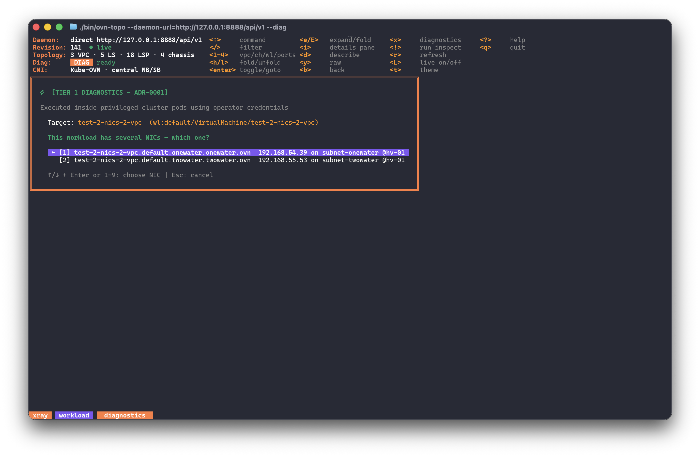 | *Suggested:* Virtual Machines › *vm* › Edit Config › Networks |
| `3`, VM unfolded: NICs on two switches | |

## UC4. Why is a pod or VM not working? (unbound port)

**Keys:** `/pending` (or the name), or scan for `✗` / `!`.

- `✗ [unbound]` on a port: no chassis claims it (`Port_Binding.chassis` is empty). The workload is scheduled but OVN has not wired it.
- `!` on a switch: it has unbound ports. The summary says how many.
- The pane says `Bound on: unbound — no Port_Binding.chassis`. Diagnostics that need a host are disabled with that reason.

| TUI | Harvester |
|---|---|
| 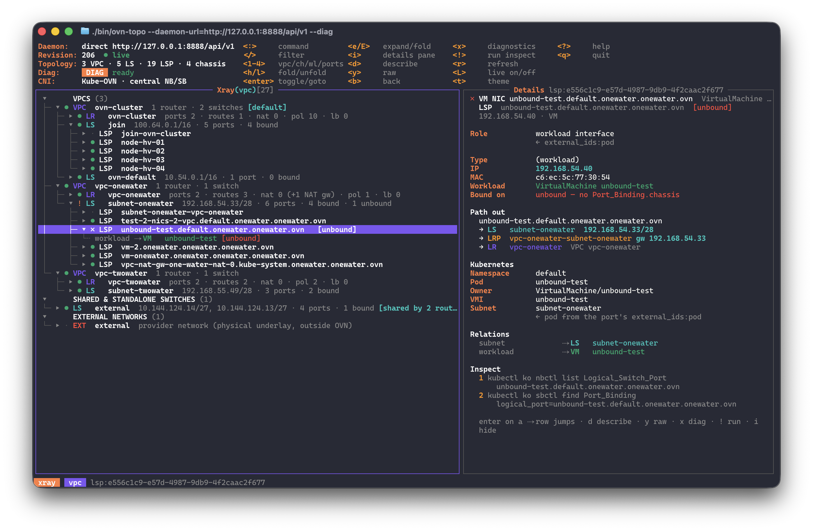 | *Suggested:* Virtual Machines list, VM in *Starting* / *Unschedulable* |
| `/pending`, unbound LSP selected | |

## UC5. How do VPCs reach each other and the nodes? (shared switches)

**Keys:** `1` → *Shared & standalone switches*.

- `join` connects every VPC router to every node's `ovn0` (100.64.0.0/16 by default). An external switch can be shared by several VPCs.
- `[shared by N routers]` plus one `router ⇢` relation per router. `Enter` on a relation jumps to that router.
- The pane lists the **connected routers**: router, VPC, through which port and network.

| TUI | Harvester |
|---|---|
| 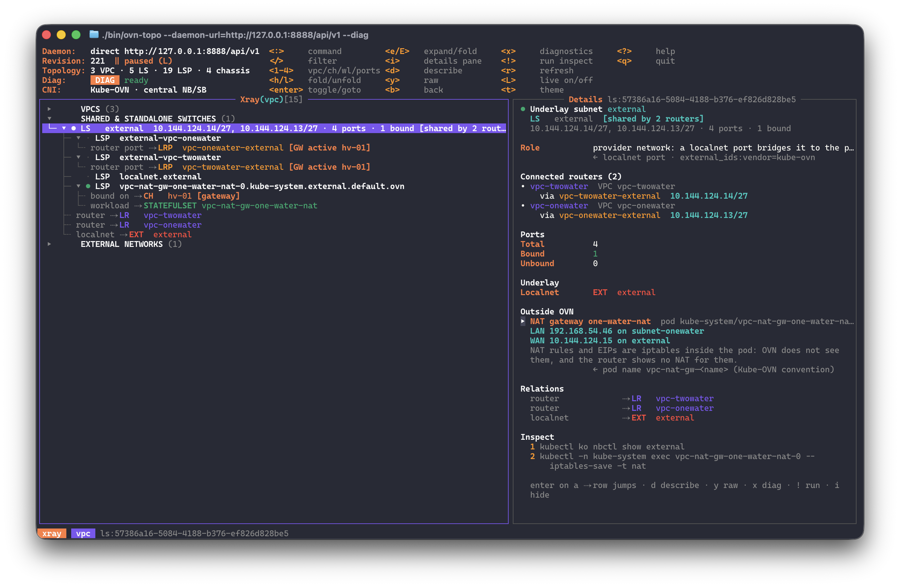 | 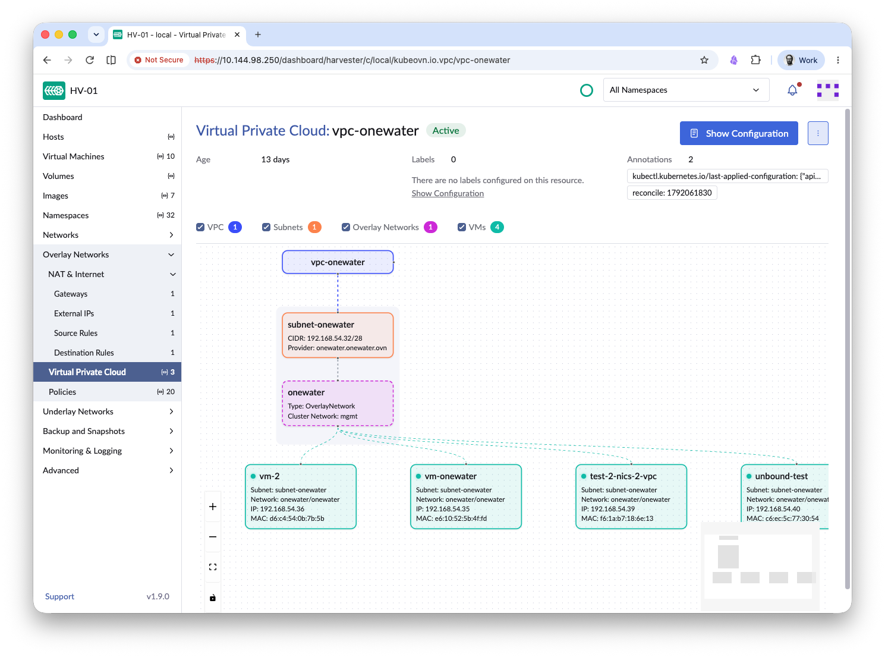 |
| `1`, `join` unfolded with `router ⇢` relations | *Suggested:* Networks › Virtual Private Cloud (VPCs and their subnets) |

## UC6. How does a VPC reach the outside? (gateway, EIP, underlay)

**Keys:** `1` → a VPC → its router → the gateway port, then *External networks*.

- A centralized gateway port carries `[GW active <chassis>]`. Its pane says **Centralized**: traffic leaves through the chassis that holds the `cr-<port>` redirect port, and *Routes out this port* shows the default route that uses it.
- A subnet gateway port is **Distributed**: every chassis routes it locally.
- *External networks* lists the provider network (the physical underlay) with its `localnet from ⇢` switch.

| TUI | Harvester |
|---|---|
| 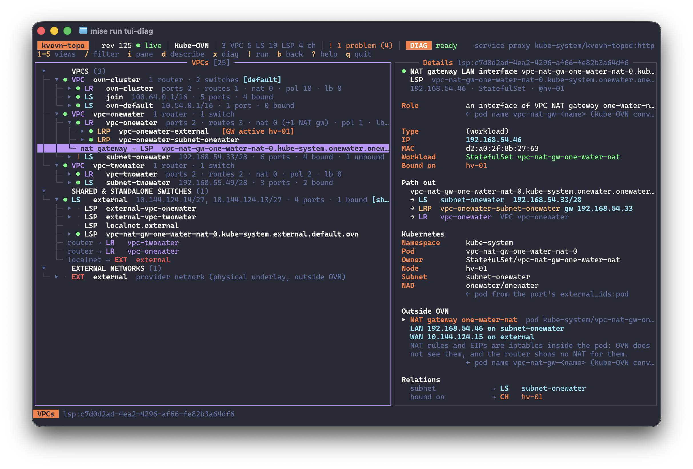 | *Suggested:* Networks › Virtual Machine Networks |
| `1`, gateway LRP selected, details pane | |
| 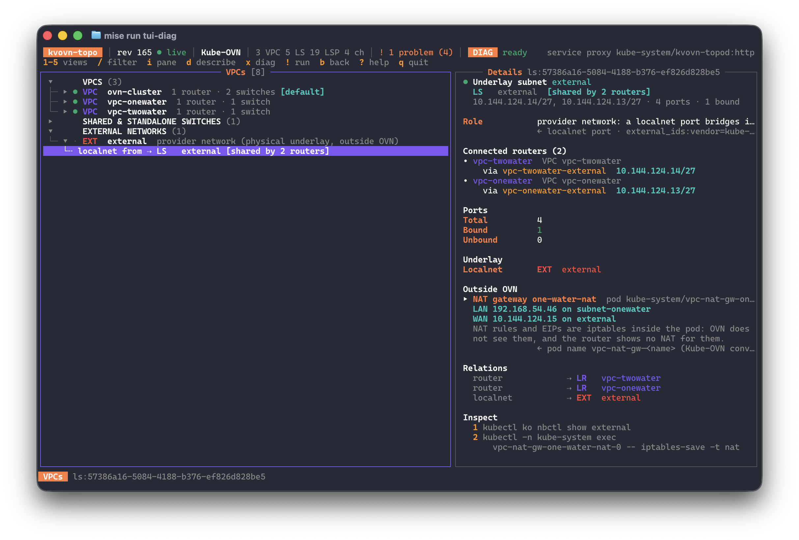 | *Suggested:* Networks › Cluster Network Configuration |
| `1`, External networks unfolded | |

## UC7. Which host runs what, and how does a chassis map to a node?

**Keys:** `2` → a chassis.

- **Chassis view:** each chassis with the ports bound on it and `active gateway for ⇢ LRP`.
- The pane shows the **System-id** (the chassis identity), hostname, encap (tunnel) IP, and `Node hv-01 ← <rule>`. The rule says how the node was matched: the `ovn.kubernetes.io/chassis` node annotation, the hostname, or a fallback.
- **Warnings:**
  - hostname-only match;
  - several chassis with the same hostname (a stale chassis after a reinstall);
  - an interconnect chassis.

| TUI | Harvester |
|---|---|
| 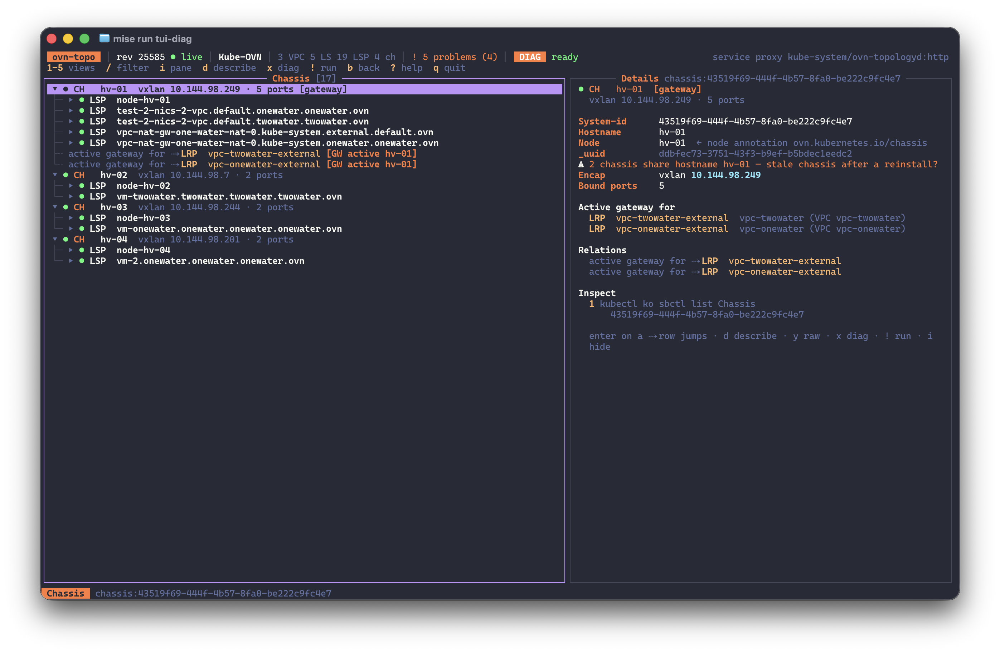 | *Suggested:* Hosts › *hv-01* |
| `2`, chassis selected, details pane | |

## UC8. Follow a relation and come back

**Keys:** unfold a port (`l`), `Enter` on `bound on ⇢ CH …`, then `b`.

- `Enter` jumps to the object in the view where it lives: a chassis opens Chassis, a workload Workloads. The path to it is expanded, and the crumbs say where you jumped.
- `b` returns to the exact row you left. On a `⇢` row the details pane already describes the target.

| TUI | Harvester |
|---|---|
| 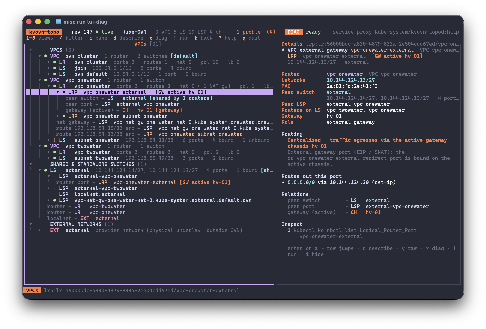 | — |
| 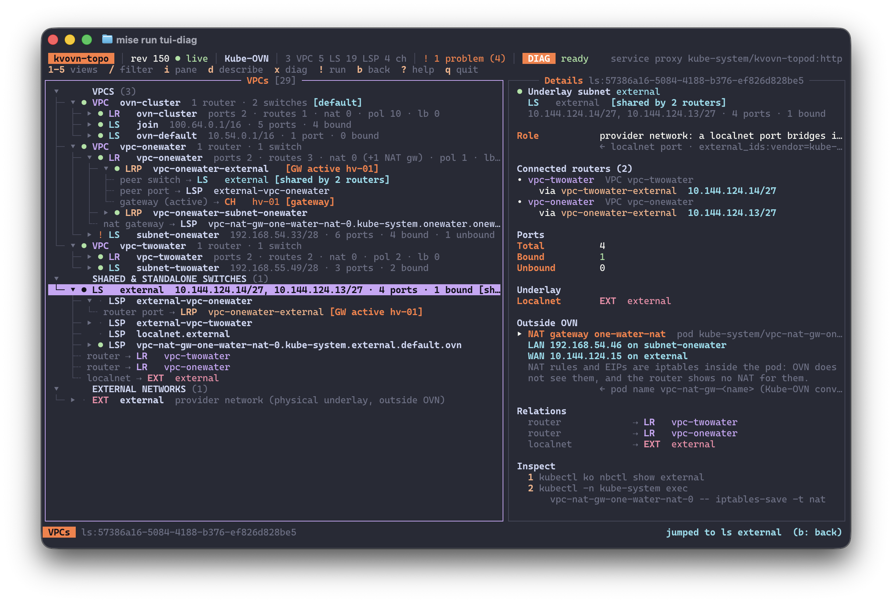 | — |

## UC9. What does OVN really store for this object?

**Keys:** `d` (describe), then `y` (raw).

- **Describe:** graph properties, Kubernetes identity (namespace, owner, VMI, node, NAD), relations, children, NB `external_ids`. Long maps unfold one entry per line.
- **Raw:** the OVSDB row, pretty-printed like `jq` and keyed by OVSDB column names (`_uuid`, `hostname`, `other_config`…). The title names the table, e.g. `SB Chassis row`.

| TUI | Harvester |
|---|---|
| 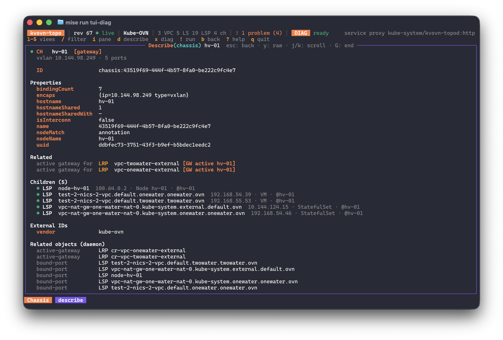 | *Suggested:* Virtual Machines › *vm* › ⋮ › Edit YAML |
| 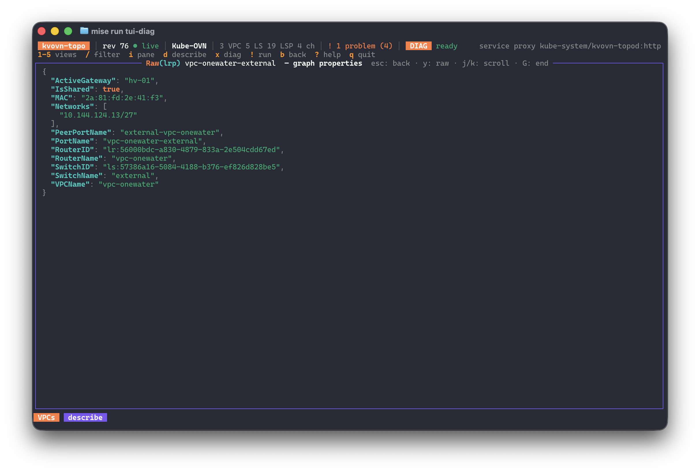 | |

## UC10. Will this packet get through? (`ovn-trace`)

**Keys:** `--diag`, select a VM NIC, `x` → `1`, pick a destination, `Enter`.

- The modal header shows the **captured target**: port, datapath, IP/MAC, and the node with where it comes from.
- **Destination tabs (`Tab`):** VM, Pod, Gateway, **Node ovn0** (a node's port on the join switch, inside OVN), **Underlay** (the chassis tunnel IP, outside OVN), Public DNS. You can also type an IP, or `IP:port`.
- **Result:** the verdict (`DELIVERED` / `DROPPED`), the hop-by-hop path and the pipeline stages. `o` shows the raw output.

| TUI | Harvester |
|---|---|
| 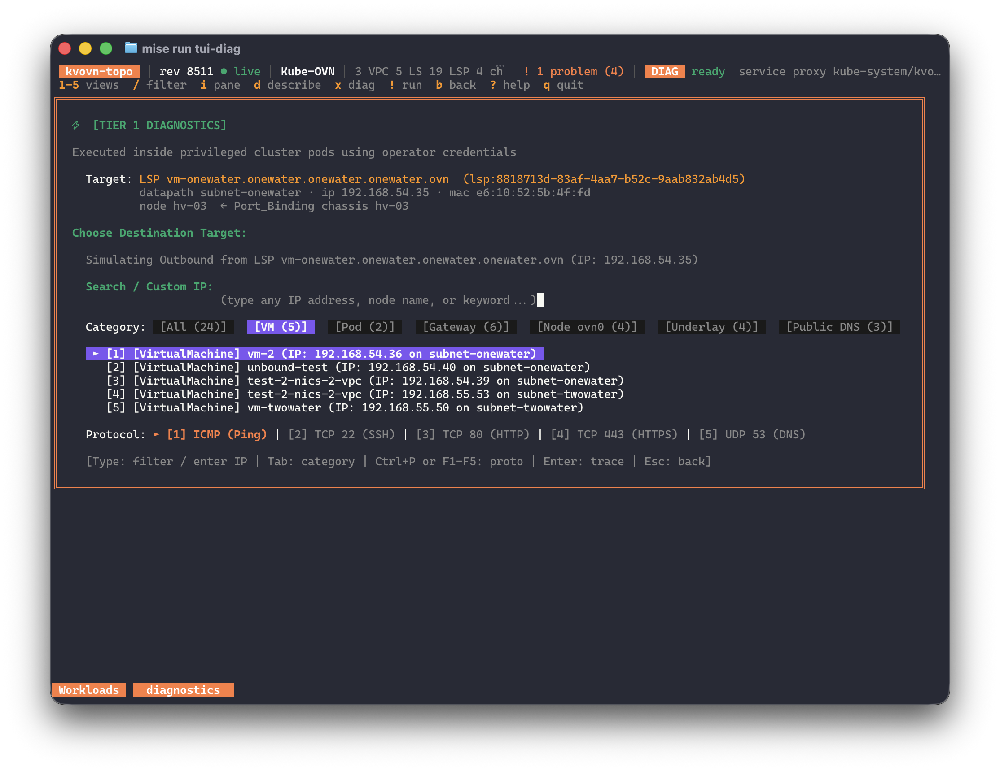 | — |
| 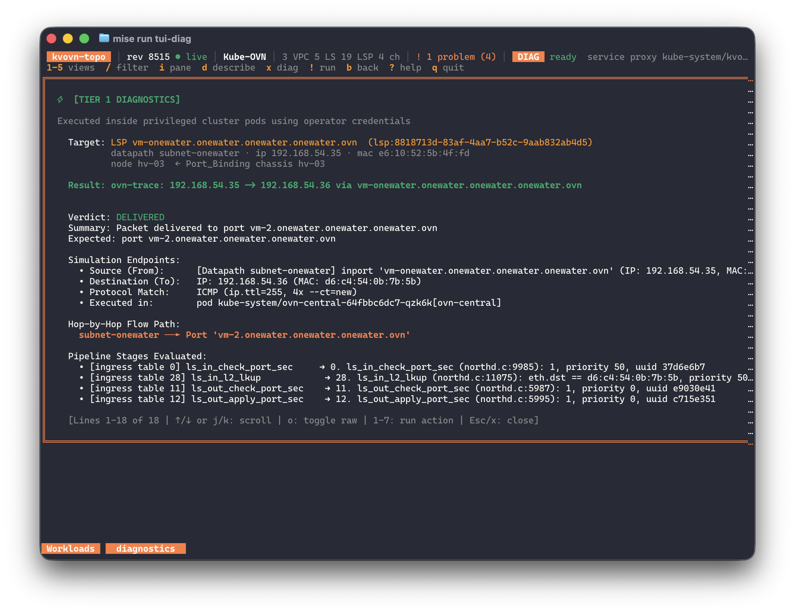 | *Suggested:* Virtual Machines › *vm* › Console (ping the same destination) |
| 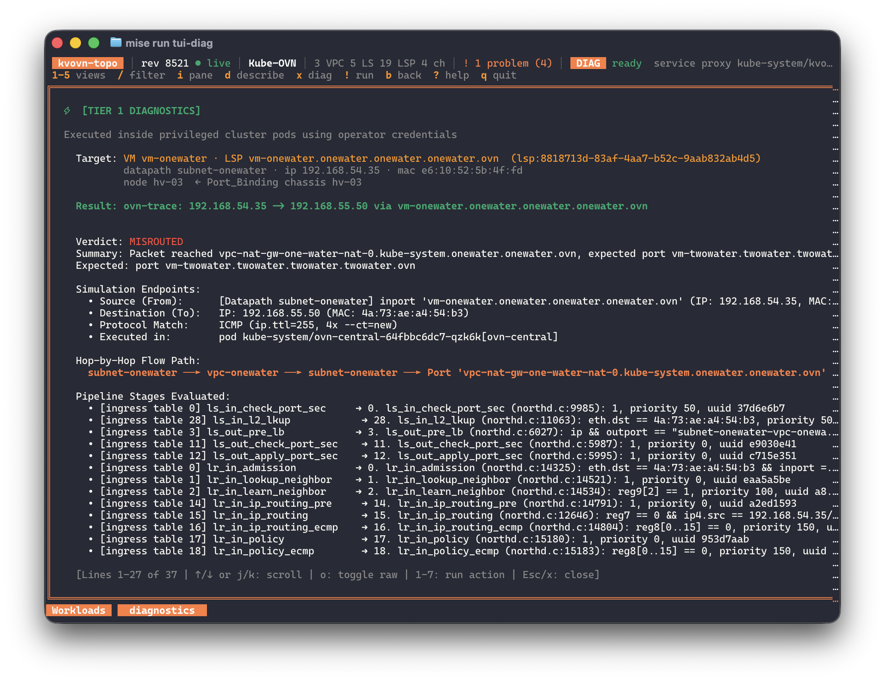 | |

## UC11. Show me the live traffic (`tcpdump`)

**Keys:** `x` → `2` on a VM NIC; or on the join router port `ovn-cluster-join`, `x` → `2`, then choose a chassis.

- **VM or pod NIC:** captures on its host veth (`<hash>_h`), on the node where OVN binds the port.
- **Join router port:** it runs on every chassis, so you pick one (`c` changes it later). The capture runs on that node's `ovn0`, filtered on the router port IP.
- **Presets:** port IP, ICMP, TCP, SSH, web, DNS, or a custom BPF filter. `Space` / `Esc` stops the capture.

| TUI | Harvester |
|---|---|
|  | *Suggested:* Virtual Machines › *vm* › Console |
| 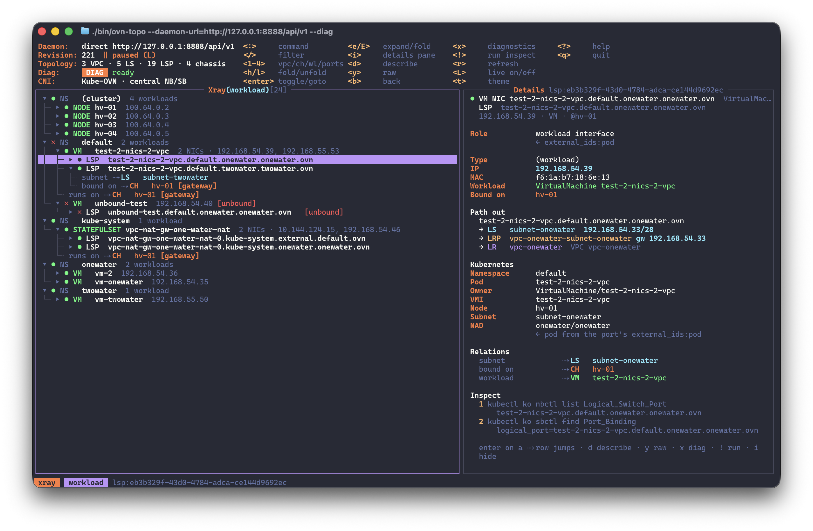 | |

## UC12. Node-level checks

**Keys:** `2` → a chassis, `x` → `3` / `5` / `6`.

- **`3` conntrack:** filtered on the port IP when started from a port, unfiltered from a chassis.
- **`5` `ovs-vsctl show`:** bridges, the Geneve tunnel mesh, BFD.
- **`6` `ovn-controller` logs** of that node.

| TUI | Harvester |
|---|---|
| 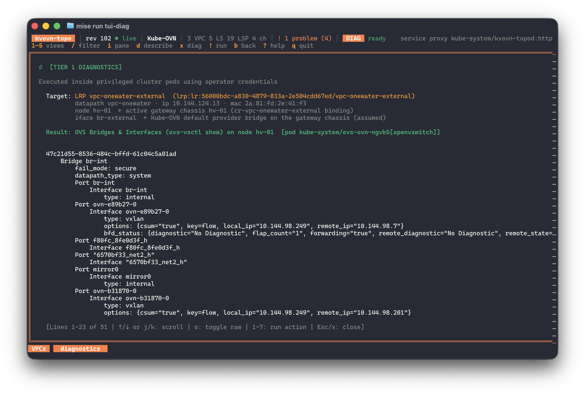 | *Suggested:* Hosts › *hv-01* › Network |
| 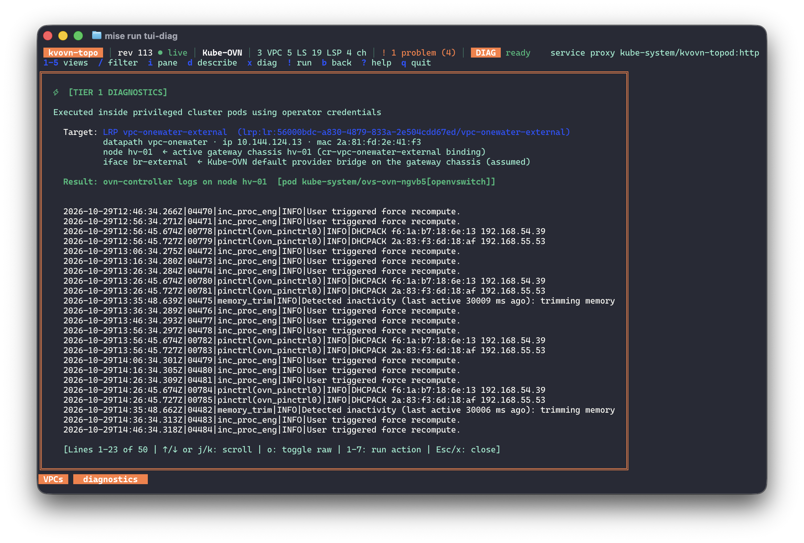 | |

## UC13. Watch a change happen (live migration, VM start)

**Keys:** keep a view open, with the header showing `● live`.

- Each change on the daemon's event stream refetches only what changed. Changed rows flash for 3 s, then keep a `▌` mark in the gutter for 15 s (`--flash`, `0` turns it off), and `5` (Changes) keeps the list: `r812 LSP vm-2… broken → ok`.
- A migrating VM's NIC moves from one chassis to another. With the diagnostics modal open on it, the modal warns `moved: hv-01 → hv-02` and re-targets the new node.
- `L` pauses and resumes the live updates; `r` reloads everything.

| TUI | Harvester |
|---|---|
| 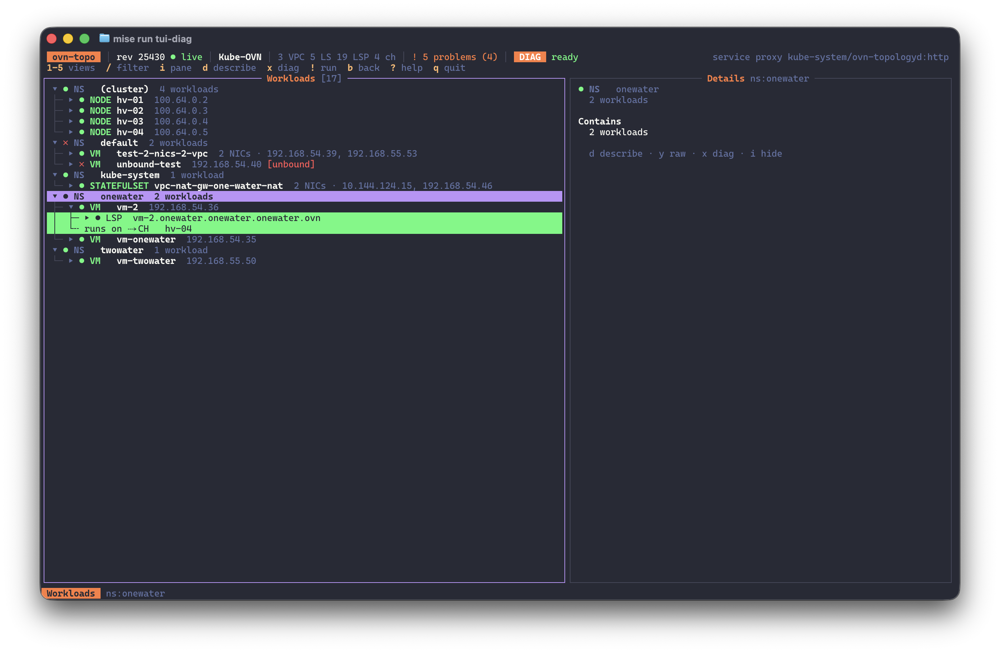 | 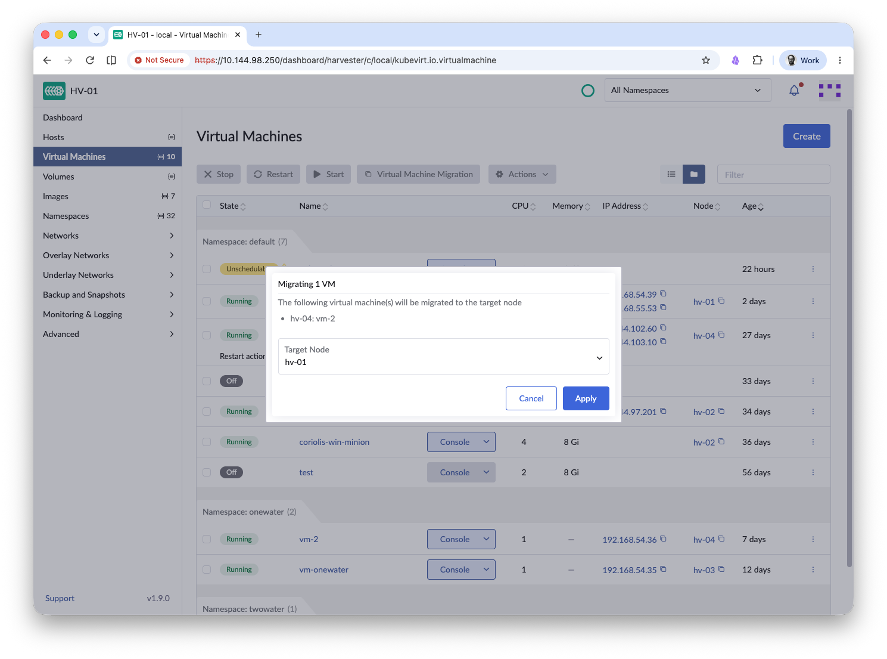 |
|  | *Suggested:* Virtual Machines › *vm* › ⋮ › Migrate |

## UC14. What is broken right now?

**Keys:** `4` (Problems). The header shows the count, e.g. `! 3 problems (4)`.

- One list, most severe first: unbound or disabled ports, gateway ports with no active chassis, chassis that match no node or share a hostname, and routers whose NAT gateway may be bypassed by replies.
- `Enter` jumps to the object in its view, `b` comes back.
- The NAT-gateway line is a heuristic: it reads `checking…` while the router's routes load, then warns when `0.0.0.0/0` leaves elsewhere and no `src-ip` route or reroute leads to the gateway. That is the one-water incident.

---

# Part 2 — Reference

## 2. Tree views — `1` `2` `3`

| Key | Root | Tree |
|---|---|---|
| `1` / `:xray vpc` | VPCs, shared & standalone switches, external networks | VPC → LR → LRP · VPC → LS → LSP |
| `2` / `:xray chassis` | chassis | chassis → LSPs bound there (+ active gateway roles) |
| `3` / `:xray workload` | Kubernetes namespaces | namespace → VM / Pod / Node → its NICs (LSPs) |

- **Rows:** fold marker (`▾`/`▸`), health glyph, kind tag, name, a dim summary (CIDR, IP, `@chassis`, counts) and a badge (`[unbound]`, `[GW active hv-01]`, `[shared by 2 routers]`).
- **Relations (`├╌ label ⇢ …`)** appear when you unfold an object.
  - They are graph edges, not ownership: `bound on` (chassis), `workload`, `router port`, `peer switch`, `peer port`, `gateway (active)`, `localnet`, and `router` (for shared switches).
  - A relation already visible as the parent or a sibling is not repeated.
- **`Enter` on a relation jumps** to that object in the view where it lives, expanding the path to it. **`b`** returns to the exact row you left.
- **Two levels start open:**
  - In VPCs you see each VPC's routers and switches with their summaries, folded. Router ports, switch ports and relations appear when you unfold.
  - Large switches, chassis and namespaces (more than 16 children) start folded even at the top.
  - `e`/`E` unfolds/folds everything visible; repeat it to go deeper.
- A multi-NIC KubeVirt VM is one workload row whose children are its NICs on different switches.

### Details pane — `i`

On terminals at least 100 columns wide, the right pane describes the selection. On a `⇢` row it describes the target, i.e. where `Enter` goes. With the pane shown, port rows drop their inline summary, because the pane carries it.

The header's `CNI` row names the conventions the TUI recognised: `Kube-OVN` when routers or switches carry `external_ids:vendor=kube-ovn`, `ovn-kubernetes · zone <node>` under `--zone` or a `zone-<node>` capture, otherwise plain `OVN`. (`t` flashes the theme name, which used to sit in that row.)

On a Kube-OVN object the pane names it the way a platform engineer does, then the OVN way (ADR-0004). The first line reads `Subnet subnet-onewater  VPC vpc-onewater`, `VPC router`, `Join subnet`, `Underlay subnet`, `VPC external gateway`, `VM NIC`, `Node join port` or `NAT gateway LAN interface`, with the OVN kind and name underneath. Objects no CNI claims keep the plain OVN header.

Anything the TUI *interpreted* rather than read from OVN gets a muted `← via …` line saying what it came from: `← external_ids:vendor=kube-ovn`, `← switch name join (Kube-OVN convention)`, `← pod name vpc-nat-gw-<name> (Kube-OVN convention)`, `← pod from the port's external_ids:pod`, or the chassis → node rule. Rows read from OVN carry none.

**Outside OVN** lists where traffic leaves OVN's view. Today that is a Kube-OVN VPC NAT gateway pod, recognised by its pod name, with its interfaces (LAN first: `LAN 192.168.54.46 on subnet-onewater`, `WAN 10.144.124.15 on external`) and a reminder that its NAT is iptables in the pod. It shows on the gateway's ports, its switches, and the router whose subnet holds its LAN side, but not on every router sharing the underlay. That router's row reads `nat 0 (+1 NAT gw)`.

**Inspect** gives the next command for the object: `kubectl ko nbctl|sbctl …` on Kube-OVN, `ovn-nbctl|ovn-sbctl …` otherwise, plus `kubectl exec … iptables-save -t nat` near a NAT gateway. With `--diag`, `!` runs a numbered line the k9s-plugin way: the TUI is suspended, the command runs in your terminal with the graph's `--kubeconfig` and `--context`, and `Enter` brings the TUI back. Several lines open a picker (`1`–`9`, or `j`/`k` and `Enter`). Only Kube-OVN lines run. `kubectl ko` needs the `kubectl-ko` plugin and follows the kubeconfig's current context, so it refuses to run under a different `--context`.

| Selection | Pane |
|---|---|
| Router | Ports & interconnections: each LRP with networks, peer switch (`shared interconnect`), MAC, active gateway · L3 counts · static routes (longest prefix first, `[ECMP]` marked), policies (by priority, with their match) and NAT, 8 rows each then `… N more (d describe)`. Next hops name their owner when the TUI knows the IP. The rows come from `/node` and are kept until the next revision; on error the pane shows the `kubectl ko nbctl` commands |
| Router port | Router/VPC, networks, MAC, peer switch + summary, peer LSP, routers on that switch, gateway, role, routing (distributed vs centralized) and what the port is for · routes out this port: the static routes whose next hop is in the port's networks or whose output port it is, such as the `0.0.0.0/0` on a gateway port |
| Switch | Connected routers (router, VPC, via which LRP and network) · port counts · localnet underlay |
| Switch port | Type, IP, MAC, workload, bound chassis (or **unbound**) · path out: `LSP → LS → LRP gw → LR (VPC)` |
| Chassis | System-id, hostname, node and the rule that linked it (annotation / hostname / fallback), `_uuid`, encaps, bound ports, active gateway for; warnings for hostname-only matches, shared hostnames and interconnect chassis |
| Workload | Kind, namespace, node, each NIC with IP, switch and chassis |
| VPC | Contents and egress gateways |

Every pane ends with the Kubernetes identity and the object's relations (`label ⇢ object`).

### Health glyphs

| Glyph | Meaning |
|---|---|
| `●` (green) | OK: port bound, switch fully bound, chassis present |
| `!` (yellow) | Degraded: switch with unbound ports, disabled port |
| `✗` (red) | Unbound port (no `Port_Binding.chassis`) or a workload with such a NIC |
| `·` (dim) | Infrastructure port (`router`, `localnet`, …): never reported as unbound |

Shapes and colours both carry the state, so it stays readable without colour.

## 3. Problems and Changes — `4` / `5`

**Problems** (`4`, `:problems`) collects what the tree already knows is wrong, most severe first. It is computed in the TUI, an interim for M4's `/checks`:

| Problem | Severity |
|---|---|
| Switch port unbound (no chassis claimed it) | ✗ |
| Gateway port with no active chassis (the VPC has no egress) | ✗ |
| Switch port disabled | ! |
| Chassis matched by hostname only, or by no node | ! |
| Chassis row that shares its hostname with the node's own chassis (the one its annotation names): possibly stale; ✗ while it still holds ports or a gateway. The node's own chassis is never listed for this | ! / ✗ |
| Router with a NAT gateway: `0.0.0.0/0` leaves elsewhere and no `src-ip` route or reroute leads to the gateway (heuristic) | ! |

Opening the view fetches the routes of every router with a NAT gateway, again after each revision.

**Changes** (`5`, `:changes`) logs what moved between revisions, newest first: `added`, `removed`, a health change (`ok → broken`), a badge change (`[unbound] → [—]`), else the new summary. It keeps 500 entries in memory from when `kvovn-topo` started; an offline fixture or paused updates say so. History across restarts is M8.

In both, `Enter` jumps to the object (a removed one says it is gone), `b` comes back, and `/` filters.

## 4. Describe & raw — `d` / `y`

- **`d` (describe):** everything known about the selected object:
  - graph properties;
  - Kubernetes identity (namespace, owner, VMI, node, NAD);
  - relations and children;
  - the daemon's `/node/{id}` detail (external_ids, related objects).

  Maps and lists that do not fit unfold one entry per line, and long values wrap.
- **`y` (raw):** the OVSDB row from the daemon.
  - Pretty-printed like `jq`: indented, sorted keys, coloured keys, strings and numbers.
  - Keyed by **OVSDB column names** (`_uuid`, `hostname`, `other_config`, as `ovn-sbctl list` shows them).
  - The title names the table, e.g. `Raw(chassis) hv-01 — SB Chassis row`.
  - Long values wrap at the box edge. Only colour is added, so the text stays valid JSON once the wraps are removed.
- **Navigation:** `j`/`k` scroll, `ctrl+d`/`ctrl+u` half a page, `g`/`G` top/end, `Esc` returns.

## 5. Filter, commands, live updates

- **`/text`:** substring filter on name, summary and badge.
  - Matching rows are shown with all their ancestors, so you keep the context: `/pod-2` shows `VPCs › default › default-subnet › app-pod-2.default`.
  - `Esc` clears it.
- **`:`:** command prompt with `Tab` completion: `vpc`, `chassis`, `workload` (`xray …` works too, k9s-style), `problems`, `changes`, `theme <name>`, `quit`.
- **Live updates:** the TUI subscribes to `/events` (SSE).
  - Each event refetches the L3 graph and only the switches whose ports changed. Unknown IDs fall back to all switches.
  - If the stream breaks, it polls `/graph` every 10 s with `If-None-Match` and keeps retrying SSE. Through Rancher's proxy the stream may be buffered: the header then shows `◌ polling`, and updates arrive every 10 s instead of instantly.
  - Rows whose content changed flash for 3 s, then keep a `▌` mark until 15 s (`--flash 30s` to keep it longer). The mark also shows on the selected row.
  - `L` pauses/resumes; `r` forces a full reload.
- **Ports are fetched completely:** L2 pages (200 ports each) are followed until the last one.

## 6. Tier 1 Diagnostics — `x` (requires `--diag`)

`x` opens the diagnostics modal for the selection: a switch port (LSP), a workload (asking which NIC when it has several), a router port or a chassis.
- Switches, routers, groups, namespaces, VPCs and external networks are not traffic endpoints, so `x` asks you to select a port or a chassis instead.
- Without `--diag`, or when RBAC denies `pods/exec`, `x` explains why instead of failing.
- The exec runs through the same kubeconfig and context as the graph (see [§0](#0-connecting)), so the diagnostics always act on the cluster you are looking at.

| Key | Action |
|---|---|
| `1` | **`ovn-trace`**<br>• **Destination picker** with fzf-style search and custom IP (`10.144.97.201` or `10.144.97.201:22`).<br>• **Category tabs** (`Tab`): All / VM / Pod / Gateway / **Node ovn0** (a node's port on the join switch, inside OVN) / **Underlay** (the chassis tunnel IP, outside OVN) / Public DNS.<br>• **Protocol presets:** `Ctrl+P`, `F1`–`F5` (ICMP, TCP 22/80/443, UDP 53).<br>• **Microflow:** starts at the **selected** port (inport, MAC, IP); traffic leaving the subnet gets the router's MAC as `eth.dst`.<br>• **Output:** verdict, hop-by-hop path, pipeline stages; `o` toggles raw output |
| `2` | **Live tcpdump**<br>• Captures on the port's own host interface: its veth (`<hash>_h`), looked up by `external_ids:iface-id` on the port's node.<br>• A centralized gateway port uses `br-external` on the active chassis; the join router port uses the chosen node's `ovn0`.<br>• Presets or a custom BPF filter.<br>• `Space`/`Esc` stops the capture |
| `3` | **Conntrack** on the node: filtered on the port IP from a port, unfiltered from a chassis |
| `4` | **OVS port interface:** link state, ofport, MTU, rx/tx counters of the port's OVS interface |
| `5` | **`ovs-vsctl show`** on the node: bridges, tunnels, BFD |
| `6` | **`ovn-controller` logs** on the node |
| `c` | **Choose the chassis** for a distributed router port |

Commands come from the typed allowlist in `pkg/diag`; nothing is built from free-form strings.

### What `x` acts on

The target is captured when you press `x` and shown at the top of the modal: the object (kind, name, ID), its datapath, IP/MAC, and the node with **where that node comes from**.
- Every action runs on exactly that target.
- Nothing is borrowed from another object.
- What cannot be derived from the selection is listed as *unavailable*, with the reason.

| Selection | Trace from | Node actions run on | Unavailable |
|---|---|---|---|
| Workload port (LSP) | the port itself (its switch, IP, MAC) | its **Port_Binding chassis** | node actions if the port is unbound |
| Infrastructure port (router / localnet) | the port, if it has an IP | — | tcpdump, conntrack, OVS port, bridges, logs |
| Router port (LRP), centralized | the router datapath, from this port | the **active gateway chassis**; tcpdump on `br-external` | OVS port |
| Router port (LRP), distributed | the router datapath, from this port | **the chassis you pick** (`c`, or asked on the first node action); tcpdump on that node's `ovn0` for the join port | OVS port; tcpdump for non-join ports (routed inside OVS, no host interface) |
| Chassis | — | that chassis | trace, tcpdump, OVS port |
| Workload (VM / Pod) | its NIC; **with several NICs you pick one first** | that NIC's chassis | as for its NIC |
| Switch, router, VPC, namespace | — | — | everything (select a port or a chassis) |

- **Kubernetes vs OVN node:** if Kubernetes reports a different node than OVN's binding (e.g. during live migration), the modal warns and uses the OVN binding.
- **Live updates while the modal is open:** they re-check the target by ID.
  - If the target disappears, the modal says so and disables the actions.
  - If it moves to another chassis, you are told and the node is updated.
  - A chosen chassis is kept.
- **tcpdump and OVS port** look up the interface whose `external_ids:iface-id` is the port, on the port's node. If none exists, the action fails with that message: it never captures on `ovn0`, `br-int` or another node instead.

## 7. Known traps (by design, also shown in `?` help)

- **VPC NAT Gateway (`Iptables*`) NAT is iptables inside a pod**, not OVN NAT. It never appears in the NB `NAT` table. The TUI counts the gateway pod separately (`nat 0 (+1 NAT gw)`) and shows it under Outside OVN.
- **Default-VPC `natOutgoing` in centralized mode** is an LR policy reroute plus node iptables, not NB `NAT`.
- **Routes, policies and NAT are configuration, not a path.** OVN routes first (longest prefix across `dst-ip` and `src-ip` routes; on a tie `dst-ip` wins), then applies policies by priority, which can allow, drop or reroute. So a `src-ip` route (Kube-OVN `policySrc`) beats `0.0.0.0/0` for traffic *from* its prefix, and a missing one is how replies can bypass a VPC NAT gateway. On the default VPC, most policies are Kube-OVN's subnet `allow` rules plus per-node `reroute` rules to node join IPs (`100.64.x.x`, shown as `node <name>`).
- **A chassis is an `ovn-controller`, not a hostname.**
  - Its identity is `Chassis.name`, the host's OVS `system-id`.
  - Kube-OVN publishes it on the Node as `ovn.kubernetes.io/chassis`, and that annotation is how a chassis is mapped to a node.
  - `Chassis.hostname` is informational and only a fallback.

  It is normally one chassis per host, but not always:
  - a reinstalled host (new system-id) can leave a stale chassis with the same hostname;
  - an OVN-IC or VTEP chassis is not a host of this cluster;
  - a node whose `ovs-ovn` is not running has no chassis.

  The chassis pane shows which rule matched and flags these cases.
- **A switch can attach to several routers** (e.g. `join`, or an external switch shared by VPCs). It is listed under *Shared & standalone switches* with `[shared by N routers]` and `router ⇢` relations to each.

## 8. Keys

| Where | Keys |
|---|---|
| Help (`?`) | `1`–`3` or `←`/`→` tab (This, Glossary, Keys) · `j`/`k` scroll · `Esc`/`q`/`?` close |
| Everywhere | `1`–`3` tree views · `4` problems · `5` changes · `:` command · `/` filter · `?` help · `r` refresh · `L` live on/off · `t` theme · `b` back · `x` diagnostics · `!` run an Inspect command (`--diag`) · `q` quit |
| Inspect picker | `1`–`9` or `j`/`k` + `Enter` run (the TUI is suspended; `Enter` returns) · `Esc` cancel |
| Tree views | `j`/`k` move · `g`/`G` top/bottom · `ctrl+d`/`ctrl+u` half page · `h`/`l` fold/unfold · `Space` toggle · `Enter` toggle or jump (`⇢`) · `e`/`E` expand/fold all · `i` details pane · `d` describe · `y` raw |
| Describe / raw | `y` toggle raw · `j`/`k` · `ctrl+d`/`ctrl+u` · `g`/`G` · `Esc` back |
| Diagnostics menu | `1`–`6` actions · `c` choose chassis (distributed port) · `Esc`/`x` close |
| Trace picker | type to search or enter an IP · `Tab`/`Shift+Tab` category · `Ctrl+P`, `F1`–`F5` protocol · `↑`/`↓` · `Enter` trace · `Esc` back |
| tcpdump | `1`–`6` preset · type a custom filter · `Enter` start · `Space`/`Esc` stop |
| Results | `j`/`k`, `PgUp`/`PgDn` scroll · `o` raw output · `Esc` back · `x` close |
